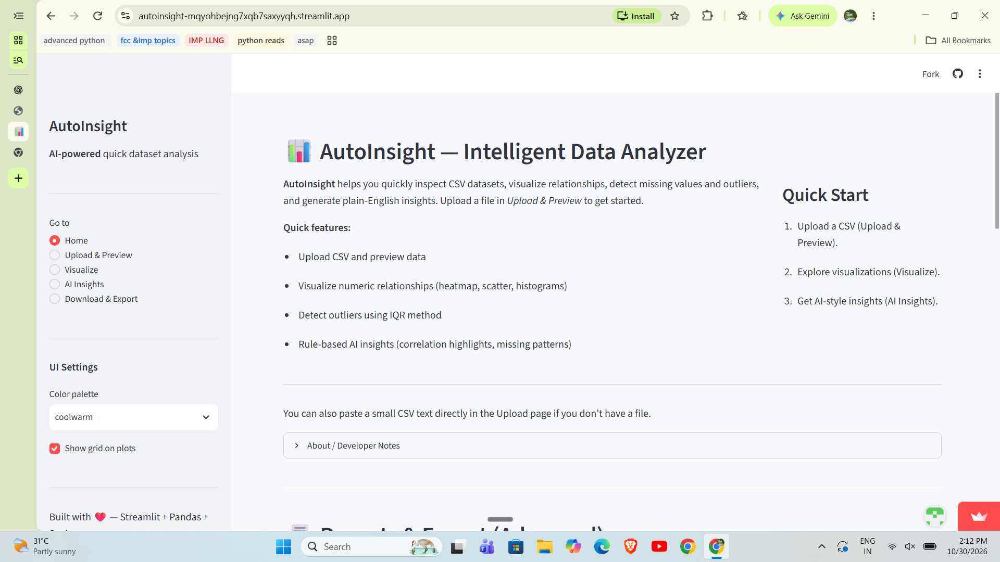
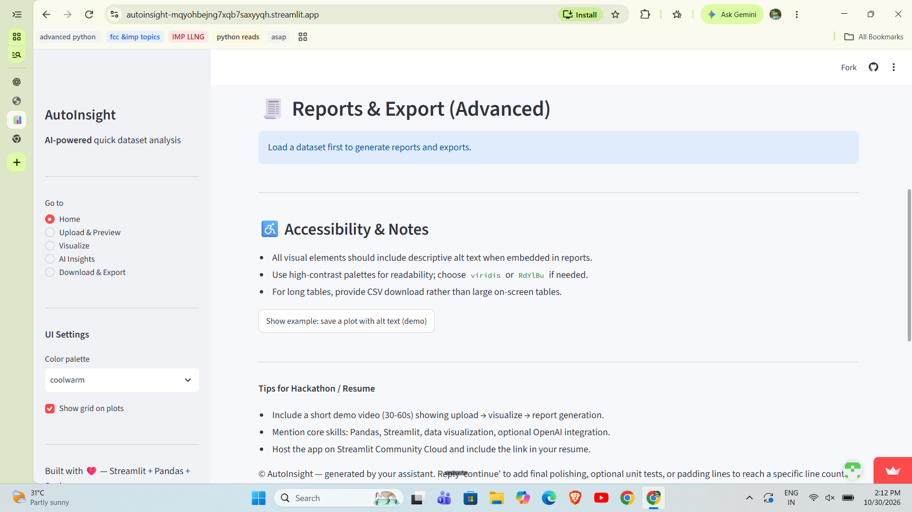
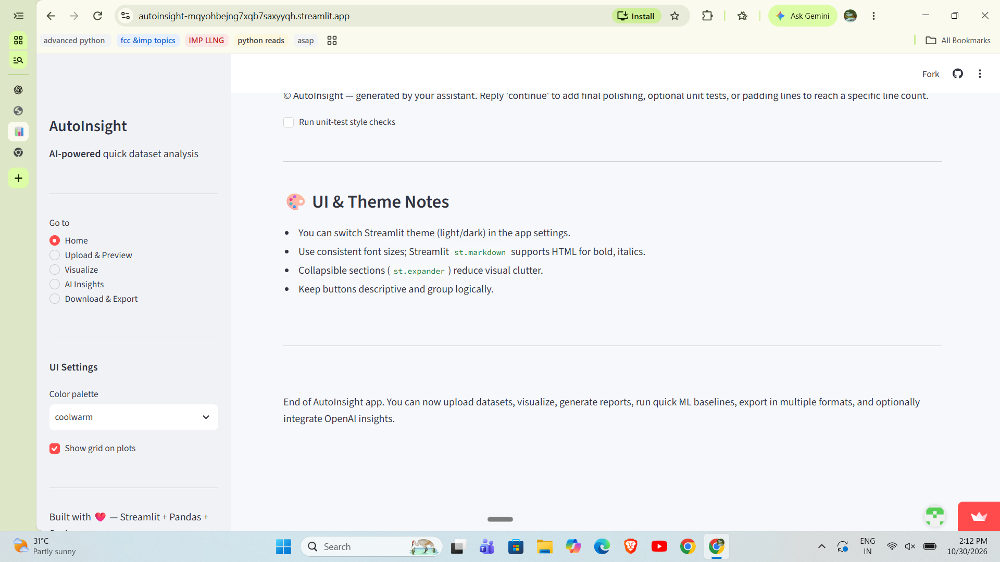

# 🚀 AutoInsight – Simple Data Analysis Web App

[](https://autoinsight-mqyohbejng7xqb7saxyyqh.streamlit.app/)

👉 **[Try AutoInsight Live](https://autoinsight-mqyohbejng7xqb7saxyyqh.streamlit.app/)**

---

## 📊 What This Project Does

AutoInsight is a simple web application that allows users to **upload a CSV file and instantly understand their data**.

Instead of writing code to analyze datasets, AutoInsight automates the process:

- Displays basic statistical information.
- Identifies patterns and relationships.
- Generates charts automatically.
- Provides a quick summary of the dataset.
- Helps users understand data through visual analytics.

It is designed to make **data analysis fast, simple, and visual**.

---

## 🧠 Why I Built This

When working with datasets, the first question is always:

> "What does this data actually contain?"

AutoInsight addresses this problem by providing an instant overview of datasets without requiring users to write any code.

---

## ✨ Features

- 📂 Upload CSV files or paste data.
- 📋 Preview datasets instantly.
- 📊 View statistics (rows, columns, missing values).
- 📈 Generate automatic visualizations:
  - Histograms
  - Boxplots
  - Scatter plots
- 🔗 Correlation heatmap to identify relationships.
- 📝 Generate simple text-based insights.
- 💾 Download cleaned datasets and analysis reports.
- 🎨 Interactive user interface with customizable themes.

---

## 📸 Screenshots

### 🏠 Home – Data Overview



### 📊 Reports & Export



### 🎨 UI & Theme



---

## 🛠️ Tech Stack

| Technology | Purpose |
|---|---|
| **Python** | Core programming language |
| **Streamlit** | Web application interface |
| **Pandas** | Data manipulation and analysis |
| **NumPy** | Numerical operations |
| **Matplotlib** | Data visualization |
| **Seaborn** | Statistical visualizations |

---

## 📂 Project Structure

```text
AutoInsight/
│
├── app.py
├── requirements.txt
├── sample_data.csv
│
└── screenshots/
    ├── Home_Screenshot.png
    ├── Reports&Export_Screenshot.png
    └── UI&Theme_Screenshot.png
